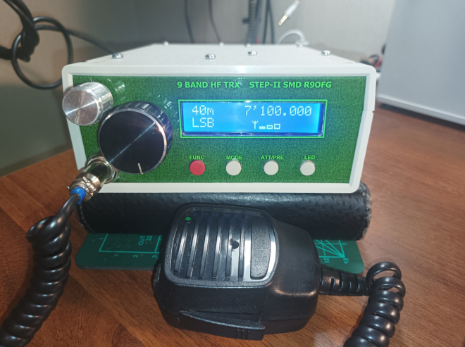
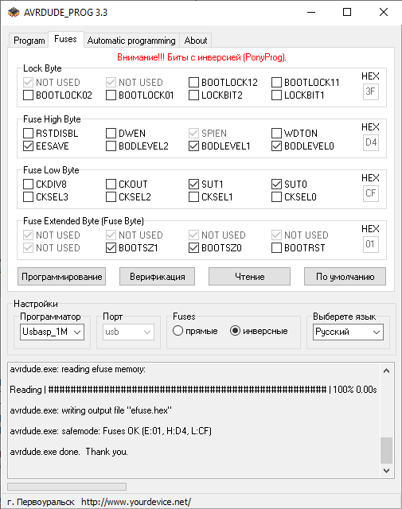
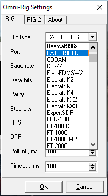
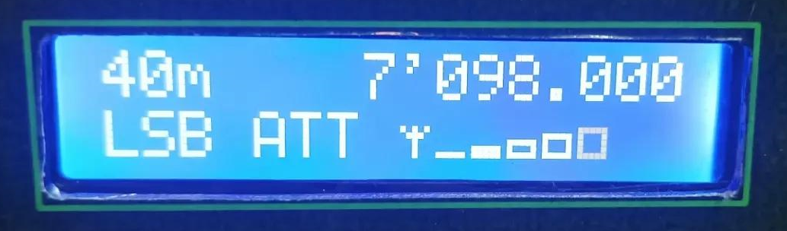
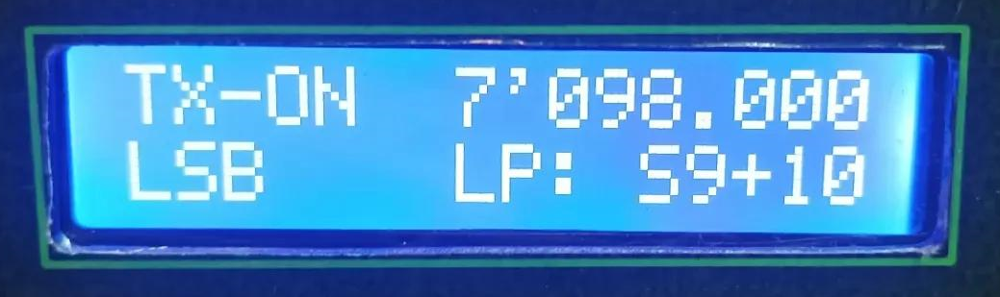

# Синтезатор на двух Si5351 для КВ трансивера с CAT

Готовые сборки и исходники прошивки HF-синтезатора на двух Si5351
(VFO + BFO), 9 КВ-диапазонов, ATmega168/328

<p align="center">
  
</p>

<p align="center">
  
  
</p>

## Возможности

* Два генератора Si5351: VFO (Si5351-1) и BFO (Si5351-2).
* 9 КВ-диапазонов (160…10 м) со своей частотой, шагом и ATT/PRE — отдельно
  для каждого диапазона.
* Диапазоны переключаются кодом ABCD через сдвиговый регистр 74HC595
  (логические уровни +5 В); в том же байте ATT/PRE (+5 В, активный высокий
  уровень), CW и PTT.
* Частота каждого диапазона запоминается через 3 с после последней
  перестройки (энкодером или по CAT) и восстанавливается при включении.
* Пределы перестройки: VFO и BFO — 1…29,999999 МГц, калибровка опоры
  XTALL-1/2 — 10…30 МГц.
* Режимы LSB, USB, CWL, CWU; преобразование «классика» или «всегда вверх».
* CAT: Kenwood-совместимый набор команд, сервисные команды управления
  настройками синтезатора из приложения (`VR`, `ST`, `LS/US/LC/UC`,
  `XT1/XT2`, `DR`, `CV`, `SW`, `BS`, `AT`, `SC`, `SM`, `TN`) и готовое описание
  Rig для OmniRig.
* S-метр: 10-битный АЦП, сглаживание, значок антенны на LCD и 7 кубиков уровней S1/3/5/7/9/9+10/9+20.
  На передаче вместо шкалы выводится пик S-метра за последние 10 с приёма в виде
  `LP: S9+10` (если сигнала не было — `LP: S0`), а при включённом тональнике —
  `Tone` / `Tow tone` (пик не показывается).
* Меню FUNC: шаг, четыре частоты BFO, калибровка XTALL-1/2, ток CLK0, вид
  преобразования, смена VFO/BFO при TX, включение/выключение диапазонов.
* Все настройки хранятся в EEPROM и сохраняются при обновлении прошивки.

| Компонент | Версия |
|---|---|
| Прошивка | **3.0.0** |
| Приложение | **3.1.0** |

## Скачать

### Прошивка

| Файл | Что это | Размер |
|---|---|---|
| [Synt_Si5351x2_R9OFG_3.0.0.hex](firmware/Synt_Si5351x2_R9OFG_3.0.0.hex) | прошивка 3.0.0 для ATmega168/328 | 40 КБ |
| [lfuse.hex](firmware/lfuse.hex) | LFUSE (0xCF) | 1 Б |
| [hfuse.hex](firmware/hfuse.hex) | HFUSE (0xD4) | 1 Б |
| [efuse.hex](firmware/efuse.hex) | EFUSE (0x01) | 1 Б |
| [lock.hex](firmware/lock.hex) | LOCK (0x3F) | 1 Б |

<p align="center">
  
  
</p>

**Как выставить в Atmel Studio 7.** Device Programming → вкладка **Fuses**:
в нижние поля вписать значения и нажать `Program`.

| Поле | Значение |
|---|---|
| **EXTENDED** | `0x01` |
| **HIGH** | `0xD4` |
| **LOW** | `0xCF` |

Вкладка **Lock bits** — без защиты. В репозитории лежит `lock.hex` со
значением `0x3F`, но в чипе при чтении обычно видно `0xFF`: биты защиты
активны по нулю, и в обоих случаях все значимые биты (LB1/LB2 и BLB01…BLB12)
равны 1 — то есть защита не включена. Отличие `0x3F` от `0xFF` только в
резервных битах 7…6 (в `0x3F` они обнулены), на работу не влияет.
Можно вообще не трогать Lock bits.

Для расширенного фьюза галочки при этом такие: `BOOTSZ` =
*Boot flash size=1024 words start address=$1C00*, `BOOTRST` — снят;
других значимых битов в EXTENDED у ATmega168 нет.

Если после чтения Studio показывает в поле EXTENDED `0xF9` — это **то же
самое состояние**: значимый бит SELFPRGEN (бит 0) в обоих случаях равен 1,
различаются только резервные биты 7…1. Писать `0x01` не обязательно, но и
вреда нет — просто обнуляются неиспользуемые биты.

`BODLEVEL` (4,3 В) задаётся в **HIGH**-фьюзе (`0xD4`), в расширенном его нет.
Ориентируйтесь на HEX-значения (0xCF / 0xD4 / 0x01 / 0x3F), а не на галочки —
в разных программах они подписаны по-разному.

### Исходники прошивки

| Файл | Что это | Размер |
|---|---|---|
| [Synt_Si5351x2_R9OFG_3.0.0_src.zip](sources/Synt_Si5351x2_R9OFG_3.0.0_src.zip) | исходники прошивки и проект Atmel Studio 7 (без приложения) | 32 КБ |

### Приложение

| Файл | Что это | Размер |
|---|---|---|
| [CAT-R9OFG-OmniRig-Client_3.1.0.msi](app/CAT-R9OFG-OmniRig-Client_3.1.0.msi) | установщик MSI (ярлыки, проверка .NET 4.8 и OmniRig) | 656 КБ |
| [CAT-R9OFG-OmniRig-Client_3.1.0.exe](app/CAT-R9OFG-OmniRig-Client_3.1.0.exe) | портативная версия: один файл (NAudio и шрифт внутри) | 1,1 МБ |

<p align="center">
  
  
</p>

<p align="center">
  
</p>

<p align="center">
  
</p>

`CAT-R9OFG-OmniRig-Client` — окно управления синтезатором по CAT через OmniRig:
частота, режимы, ATT/PRE, тональник, менеджер частот, настройки синтезатора.
Для работы требуется установленный OmniRig версии 1.1 или 1.2
(рекомендуется 1.2).

Требуется только .NET Framework 4.8 (входит в Windows 10/11). Приложение
собрано одним файлом: NAudio и шрифт дисплея Terminus внутри exe, рядом ничего
не нужно. `CAT_R9OFG.ini` копируется в `Rigs` OmniRig
(`C:\Program Files (x86)\Afreet\OmniRig\Rigs`); если файла там нет, программа
сама предложит его скопировать при первом запуске. После копирования OmniRig
нужно перезапустить — иначе `CAT-R9OFG` не появится в списке Rig 1/2.

<p align="center">
  
</p>

Загрузка актуального расписания вещания на КВ — из контекстного меню правой
кнопкой мышки по области таблицы КВ вещания, расписание загружается с сайта
[eibispace.de](https://www.eibispace.de/).

<p align="center">
  
</p>

**Элементы управления**

*Главное окно:*

* `Rig1` / `Rig2` — слот OmniRig, через который идёт управление; `Rig` — открыть
  окно настроек OmniRig.
* `< BAND` / `BAND >` — предыдущий / следующий включённый диапазон.
* `ATT/PRE` — аттенюатор/предусилитель: ATT → нет → PRE.
* `MODE` — LSB → USB → CWL → CWU.
* `PTT on/off` (или `Esc`) — передача / приём.
* `One tone` / `Tow tone` — тональник: один тон или два (второй выше первого
  по частоте на заданную разницу).
* `Advanced options >>` / `<<` — панель: `Output audio device` (устройство
  вывода звука с ПК на трансивер), ползунок уровня 0…100 % выводимого звука
  на трансивер, `Freg first tone` и `Freg differ
  tone` (частоты тонов, Гц), `Enable limit tuning to tone` (предел настройки
  тоном, в секундах), `Disable sound output on PC when PTT` — при передаче
  отключает вывод звука ПК на устройстве по умолчанию; полезно при плохой
  шумовой обстановке в городских условиях, когда приёмником служит ближайший
  интернет/WebSDR-приёмник, `Always on top` — главное окно приложения всегда
  на переднем плане.
* `Frequency manager show` — менеджер частот; `Synthesizer settings` —
  настройки синтезатора.
* Дисплей: RX/TX, режим, диапазон, частота, `Signal level: S…` (пиковое значение), дата/время UTC.
  Колесо мыши над разрядами частоты — перестройка (над точкой — ±500 Гц),
  двойной клик — цвет символов дисплея приложения.

*Настройки синтезатора:*

* `BFO LSB/USB/CWL/CWU`, `XTALL-1`, `XTALL-2` — частоты в Гц.
* `Step` — шаг перестройки, `CLK0 Si-1` / `CLK0 Si-2` — ток драйвера,
  `Conversion` — классика / всегда вверх, `Swap freq on TX` — смена частот
  VFO/BFO при передаче.
* `Bands` — галочки включения 9 диапазонов; `ATT/PRE by band` — списки
  off/ATT/PRE для каждого диапазона.
* `S-meter calibration (ADC 0..255)` — 7 порогов S1…S9+20 с подписями
  стандарта в dBm и мкВ, под ними текущее `S-meter ADC`.
* `Firmware:` — версия прошивки, прочитанная по CAT.
* `Read` — прочитать из синтезатора, `Apply` — записать, `Save...` / `Load...` —
  сохранить/загрузить настройки в файл `*.syn`, `Close`.

**Как выбираются частоты BFO (фильтр ПЧ).** Значения берутся по уровню
−6 дБ с АЧХ используемого фильтра ПЧ: `BFO LSB` — у нижнего ската полосы,
`BFO USB` — у верхнего, ±200…300 Гц соответственно. Если фильтр имеет полосу
`B` по −6 дБ и центр `f0`:

* `BFO LSB` = `f0 − B/2`, `BFO USB` = `f0 + B/2`; разница между ними равна
  полосе фильтра — заводские 8 865 000 и 8 868 000 Гц соответствуют центру
  8 866 500 Гц и полосе 3 кГц;
* `BFO CWL` / `BFO CWU` — те же скаты CW-фильтра с поправкой на желаемый тон
  (обычно 600…800 Гц);
* при классическом преобразовании используются только `BFO LSB` и `BFO CWL`
  (BFO всегда ниже полосы фильтра), в режиме преобразования «всегда вверх» —
  все четыре значения;
* точнее всего выставлять BFO по максимальному подавлению ненужной боковой
  полосы и минимальным искажениям — на слух или по S-метру.

*Менеджер частот:*

* Вкладки `My freq` и `EiBi shortwave schedules`.
* `Freq`, `Mode`, `Comment` и `Add` — добавить запись в свой список.
* `Search:` — поиск по частоте, режиму и комментарию.
* Двойной клик по строке — переход на частоту и режим; правый клик по строке —
  удалить.
* В EiBi: `Current time UTC`, `Broadcast language`, `± hours` — фильтры,
  `Hide window` — скрыть окно.
* Строки расписания подсвечиваются **зелёным**, когда передача идёт сейчас:
  текущее время UTC попадает в интервал вещания и день недели указан в
  расписании. Подсветка обновляется раз в минуту, поэтому видно, какие
  станции работают в данный момент.
* Двойной клик по выбранной строке устанавливает указанную частоту на
  синтезаторе.
* Правый клик по таблице КВ вещания — загрузка/обновление расписания с
  eibispace.de либо очистка таблицы.

**Органы управления синтезатора:**

* Энкодер — перестройка в основном режиме, выбор значения в меню настроек.
* Частота диапазона запоминается через 3 с после последней перестройки —
  энкодером или по CAT (`FA...;`).
* `FUNC` — короткое нажатие (до 1 с): следующий включённый диапазон.
  Удержание 1…5 с: меню `Select step` (выбор шага перестройки: 1, 10, 100,
  500 Гц, 1, 10, 100 кГц). Удержание 5 с и более:
  настройки, первый пункт `Freq BFO-LSB`. Короткое нажатие в меню — следующий
  пункт: шаг → BFO-LSB → BFO-USB → BFO-CWL → BFO-CWU → XTALL-1 → XTALL-2 →
  DrvSt Si-1 → DrvSt Si-2 → Set conversion → Swap freq on TX → Use bands;
  в `Use bands` короткое нажатие — следующий диапазон (160…10 м), а
  включение/выключение каждого — вращением энкодера (on/off); после 10 м —
  выход в основной режим. Шаг перестройки выбирается и в самих пунктах
  настройки BFO (LSB/USB/CWL/CWU) и опоры XTALL-1/XTALL-2: удержание `FUNC`
  1…5 с там открывает `Select step`. Ток драйвера микросхем
  (`DrvSt Si-1` / `DrvSt Si-2`) выбирается вращением энкодера.
* `ATT/PRE` — нажатие от 32 мс: ATT → нет → PRE → нет.
* `MODE` — нажатие от 32 мс: LSB → USB → CWL → CWU; в классическом
  преобразовании недоступные моды пропускаются.
* `PTT` — удержание от 64 мс: передача, отпускание — приём.
* Кнопки подключены к одному входу ADC0 через резистивный делитель,
  антидребезг 32 мс.

### Дисплей синтезатора

<p align="center">
  
  
</p>

**Приём:**

Верхняя строка — диапазон `40m` и частота настройки `7.098.000`. Нижняя
строка — режим `LSB`, метка `ATT` (аттенюатор; может быть `PRE`
(предусилитель) или пусто — показывается состояние текущего диапазона),
значок антенны и шкала S-метра.

**Передача:**

Верхняя строка — `TX-ON` (идёт передача) и частота. Нижняя строка — режим
`LSB`; метка ATT/PRE на время передачи убрана, вместо шкалы S-метра справа
выводится `LP: S9+10` — пик S-метра за последние 10 секунд приёма (`LP` —
last peak). Если сигнала не было — покажет `LP: S0`. При работе тональника
вместо пика показываются `Tone` (один тон) или `Tow tone` (два тона).

### Документация

| Файл | Что это | Размер |
|---|---|---|
| [Synt_si5351_avr_5v_2.1.pdf](docs/Synt_si5351_avr_5v_2.1.pdf) | принципиальная схема | 202 КБ |
| [CAT_R9OFG.ini](docs/CAT_R9OFG.ini) | описание Rig для OmniRig | 2 КБ |

## Состав репозитория

```
firmware/   прошивка (hex) и файлы фьюзов
sources/    архив исходников прошивки
app/        приложение: портативный EXE и установщик MSI
docs/       схема, CAT_R9OFG.ini
```

## Лицензия

Проект распространяется по лицензии MIT:
[английский текст](LICENSE) · [русский перевод](LICENSE.ru.txt).

Сайт: [r9ofg.ru](https://r9ofg.ru)

73!
