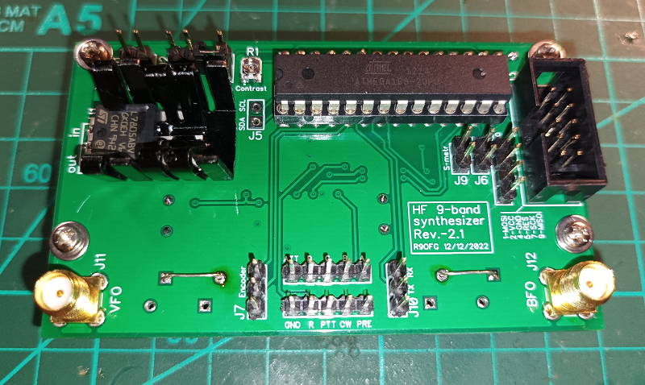
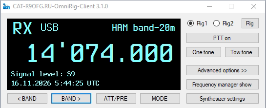
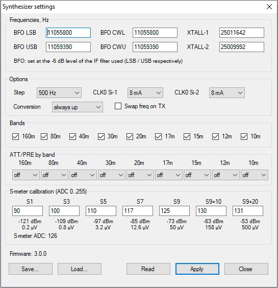
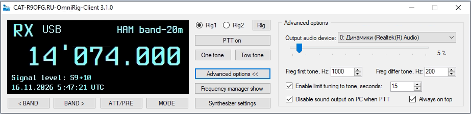
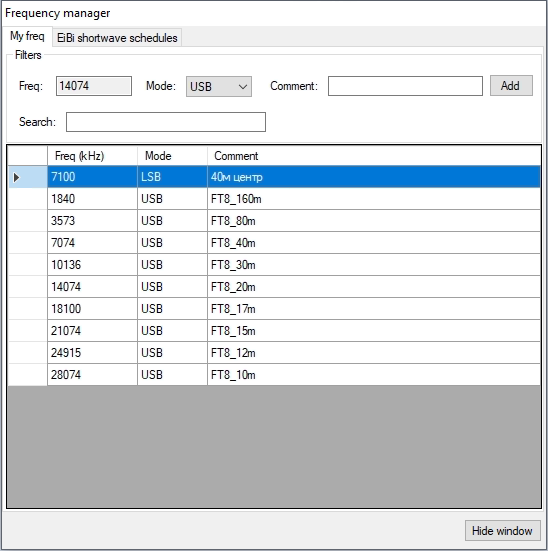
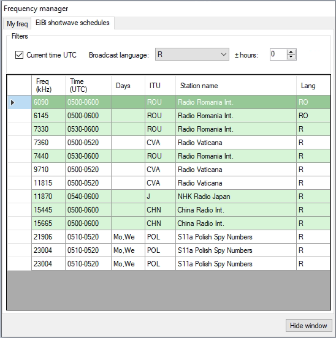

# Синтезатор на двух Si5351 для КВ трансивера с CAT

Готовые сборки и исходники прошивки HF-синтезатора на двух Si5351
(VFO + BFO), 9 КВ-диапазонов, ATmega168/328

<p align="center">
  
</p>

<p align="center">
  
  
</p>

## Возможности

* Два Si5351: VFO (Si5351-1) и BFO (Si5351-2), выбор микросхемы по шине I2C.
* 9 КВ-диапазонов (160…10 м) со своей частотой, шагом и ATT/PRE.
* Режимы LSB, USB, CWL, CWU; преобразование «классика» или «всегда вверх».
* CAT: Kenwood-совместимый набор команд и готовое описание Rig для OmniRig.
* S-метр: 10-битный АЦП, сглаживание, значок антенны на LCD и 7 кубиков уровней S1/3/5/7/9/9+10/9+20
* Меню FUNC: шаг, четыре BFO, калибровка XTALL-1/2, ток CLK0, вид
  преобразования, смена VFO/BFO при TX, включение/выключение диапазонов.
* Все настройки хранятся в EEPROM и сохраняются при обновлении прошивки.

| Компонент | Версия |
|---|---|
| Прошивка | **3.0.0** |
| Приложение | **3.1.0** |

## Скачать

### Прошивка

| Файл | Что это | Размер |
|---|---|---|
| [Synt_Si5351x2_R9OFG_3.0.0.hex](firmware/Synt_Si5351x2_R9OFG_3.0.0.hex) | прошивка 3.0.0 для ATmega168 | 40 КБ |
| [lfuse.hex](firmware/lfuse.hex) | LFUSE (0xCF) | 1 Б |
| [hfuse.hex](firmware/hfuse.hex) | HFUSE (0xD4) | 1 Б |
| [efuse.hex](firmware/efuse.hex) | EFUSE (0x01) | 1 Б |
| [lock.hex](firmware/lock.hex) | LOCK (0x3F) | 1 Б |

<p align="center">
  
  
</p>

### Исходники прошивки

| Файл | Что это | Размер |
|---|---|---|
| [Synt_Si5351x2_R9OFG_3.0.0_src.zip](sources/Synt_Si5351x2_R9OFG_3.0.0_src.zip) | исходники прошивки и проект Atmel Studio 7 (без приложения) | 32 КБ |

### Приложение

| Файл | Что это | Размер |
|---|---|---|
| [CAT-R9OFG-OmniRig-Client_3.1.0.msi](app/CAT-R9OFG-OmniRig-Client_3.1.0.msi) | установщик MSI | 656 КБ |

<p align="center">
  
  
</p>

<p align="center">
  
</p>

<p align="center">
  
  
</p>

`CAT-R9OFG-OmniRig-Client` — окно управления синтезатором по CAT через OmniRig:
частота, режимы, ATT/PRE, тональник, менеджер частот, настройки синтезатора.
Для работы требуется установленный OmniRig версии 1.1 или 1.2
(рекомендуется 1.2).

Требуется только .NET Framework 4.8 (входит в Windows 10/11).
`CAT_R9OFG.ini` копируется в `Rigs` OmniRig
(`C:\Program Files (x86)\Afreet\OmniRig\Rigs`), после чего OmniRig нужно
перезапустить — иначе `CAT-R9OFG` не появится в списке Rig 1/2. Смена цвета
символов дисплея приложения — двойной клик мышкой по области дисплея.

### Документация

| Файл | Что это | Размер |
|---|---|---|
| [Synt_si5351_avr_5v_2.1.pdf](docs/Synt_si5351_avr_5v_2.1.pdf) | принципиальная схема | 202 КБ |
| [CAT_R9OFG.ini](docs/CAT_R9OFG.ini) | описание Rig для OmniRig | 2 КБ |

## Состав репозитория

```
firmware/   прошивка (hex) и файлы фьюзов
sources/    архив исходников прошивки
app/        приложение: установщик MSI
docs/       схема, CAT_R9OFG.ini
```

## Лицензия

Проект распространяется по лицензии [MIT](LICENSE) — текст на английском
и русском языках.

Сайт: [r9ofg.ru](https://r9ofg.ru)

73!
